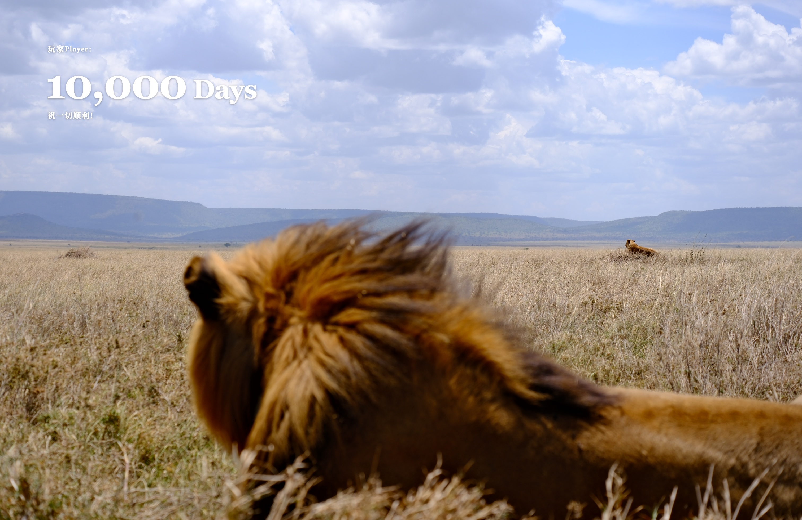
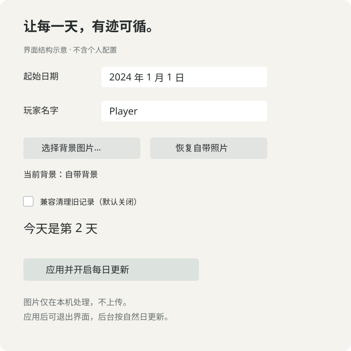

# 人生天数壁纸 / Life Days Wallpaper

[](https://github.com/lizhuohui777/life-days-wallpaper/actions/workflows/macos.yml)

**把人生的每一天，放进你喜欢的风景里。**

一个 macOS 原生小工具：选择你的照片、起始日期和玩家名字，让桌面每天自动显示人生天数。起始当天计为第 1 天。



狮子照片由作者本人拍摄，展示用户自行导入图片后的效果。预览中的 `Player` 和 `10,000 Days` 为演示数据，不包含个人日期或原始照片元数据。

### 换成你自己的照片

打开应用 → 点击 **「选择背景图片…」** → 选择照片 → 点击 **「应用并开启每日更新」**。图片由用户自行选择并导入，所有处理都在本机完成，不上传服务器。

喜欢预览里的狮子？仓库附赠一张已清除隐私元数据的 [狮子照片](bonus/lion.jpg)，下载后也可以按上述步骤导入。使用范围见 [附赠图片说明](bonus/README.md)。

程序默认仍使用自动生成的山丘示例背景。狮子照片位于独立的 `bonus/` 目录，不会被自动打包成程序默认背景。

### 查看原生界面结构与默认背景




界面图为结构示意，非系统截图；两张壁纸图均由程序预览模式生成。


## 功能

- 设置起始日期、玩家名字，显示天数与祝福语。
- 导入 JPEG、PNG、HEIC、TIFF；恢复自带背景。
- 每 60 秒检查日期，按本机时区的自然日更新；休眠期间不运行。
- 每天覆盖一个固定图片文件，不积累日期版本。
- 可选的旧墙纸记录清理，默认关闭；不修改 Dock 或 Command＋Tab 设置。

## 系统要求与安装

macOS 13 或更新版本，Apple 芯片或 Intel Mac。源码构建需要 Xcode Command Line Tools，测试与公开源码导出需要 Python 3。

若仓库已发布正式 Release，可从该仓库的 Releases 下载 DMG，将应用拖到“应用程序”，打开后选择日期、名字及背景，点击“应用并开启每日更新”。首次应用可能需要允许自动化控制 System Events。

当前是非沙箱本地版，构建脚本仅使用临时签名，没有 Developer ID 签名或 Apple 公证。不要关闭 Gatekeeper；公开分发前应完成签名和公证。

## 从源码构建

在这个 README 所在目录执行：

```sh
zsh scripts/test.sh
zsh 构建安装包.command --app-only
open dist/人生天数壁纸.app
```

生成 DMG：

```sh
zsh 构建安装包.command
```

脚本会创建完整应用结构并构建 arm64 / x86_64 通用二进制，不依赖已安装应用。输出位于 `dist/`。本机存在 `资源/background.jpg` 时使用它；该本机文件默认不加入仓库，缺少它时自动生成程序化山丘背景。附赠照片不会被构建脚本自动读取。

## 图片与隐私

图片只导入本机，不发送到服务器。导入上限为 50 MiB、8000 万像素，最长边归一化为 6240 像素；重新编码时不复制源定位、拍摄时间或相机信息。JPEG 编码器仍可能生成颜色空间、像素尺寸等技术属性。

照片权利与代码许可分别管理，见 [素材说明](ASSETS.md) 和 [许可状态](LICENSE)。狮子照片由项目作者提供为单独附赠素材，可下载并用作本项目的个人壁纸；代码许可与照片使用范围分别说明。原始拍摄文件及个人配置不随仓库发布。

## 配置、停用和卸载

设置、背景副本、生成壁纸和日志位于 `~/Library/Application Support/DayWallpaper/`。登录任务位于 `~/Library/LaunchAgents/local.daywallpaper.plist`。已应用后可退出图形界面，后台检查仍按用户开启的任务运行。

```sh
launchctl bootout "gui/$(id -u)/local.daywallpaper"
```

随后到系统设置选择其他墙纸，再手动删除该登录任务文件、应用和上述配置目录。删除前如需保留照片、日期设置或日志，请先备份。[详细卸载与恢复](docs/UNINSTALL.md)。

## 已知限制

固定画布为 3024 × 1964，不同屏幕比例或锁屏时钟下可能裁切或遮挡；不提供视频屏保。不同桌面空间可能保留系统自己的配置。兼容清理依赖未公开的系统存储格式，未来 macOS 版本可能变化，应只在确有旧记录问题时勾选。

当前版本不适合直接提交 Mac App Store，见 [发布说明](docs/RELEASING.md)。首次 GitHub macOS CI 已通过，覆盖共享逻辑测试、通用架构构建和独立预览；这不能替代实际系统交互或 App Review。

## 项目结构

`WallpaperApp.swift` 为图形界面；`DayWallpaper.swift` 为渲染与每日更新入口；`Shared.swift` 为日期、导入和迁移逻辑。`Tests/` 为合成数据测试，`scripts/` 为测试、素材隐私和安全导出工具，`AppInfo.plist` 为版本与应用信息。

贡献方式见 [CONTRIBUTING](CONTRIBUTING.md)。问题报告请删除个人路径、姓名、日期与照片后再提交。

本地检查结果见 [验证记录](docs/VALIDATION.md)。
